<!---
chandana-galgali/chandana-galgali is a ✨ special ✨ repository because its `README.md` (this file) appears on your GitHub profile.
You can click the Preview link to take a look at your changes.
--->

  

<h1 align="center">
  Let's Connect and have a Chat!💬
</h1>

---

<h2> 👩‍💻 &nbsp;About Me</h2>

Hi there 👋 I just genuinely love engineering and building cool things! 🚀

* 👂 **My name is**: Chandana Ramesh Galgali
* 👩 **Pronouns**: She/Her | 🌍 **Located in**: Mumbai, India
* 🎓 **Education**: B.Tech in IT with Honors in AI from KJSCE (2026)
* 🎯 **Philosophy**: I believe the best developers are versatile. I love mixing domains that traditionally shouldn't mix!

💼 **My Versatile Work Experiences**:
* **Research Intern @ IIT Bombay**: Exploring JIT compilers and dynamic language optimizations
* **SDE Intern @ Barclays**: Built real-time SLA monitoring pipelines and predictive AI PoCs
* **Web App Security Intern @ Keva**: Conducted vulnerability analysis and penetration testing
* **Machine Learning Intern @ Prodigy InfoTech**: Built end-to-end predictive and CV models
* **Java Developer Intern @ Keva**: Java backend development with Maven
* **Web Development Intern @ KJSCE**: Developed interactive virtual lab for students

🌟 **Leadership & Open Source**: 
* **Tech Contributor @ GirlScript Summer of Code**: Contributed to open-source tech initiatives
* **General Secretary @ Team Emfinity**: Led a 30-member team and managed tech events

🔭 **My Featured Repositories**:
* AI-Powered Multi-Pollutant Mapping for Hyperlocal Air Quality Monitoring (Climate Hackathon 2024, Winner + 1.5 Lakh Grant to implement solution on university campus) 🏆
* Voice-Enabled Geospatial UI (ISRO Bharatiya Antariksh Hackathon 2024) 🗺️
* Text-to-AR/VR : Generating AR/VR Visualization from Textual Description of Numerical Data 🥽
* Automated Caption Generation using Encoder-Decoder Model for Targetted Objects (Jewellery Images) 🖼️

 

💬 **You can talk to me about**: AI applications, Compiler Optimizations, System Architecture, F1 constructor strategies or even One Piece lore lol! 
📫 **How to reach me**: chandana.galgali@gmail.com

--- 
  
<h2> 🚀 &nbsp;Tools that I Have Used and Explored</h2>
<table>
  <tr>
    <td align="center"> VS Code</td>
    <td align="center"> Docker</td>
    <td align="center"> Kubernetes</td>
    <td align="center"> FastAPI</td>
    <td align="center"> Flask</td>
    <td align="center"> C</td>
    <td align="center"> C++</td>
    <td align="center"> Java</td>
    <td align="center"> Spring</td>
  </tr>
  <tr>
    <td align="center"> Python</td>
    <td align="center"> PyTorch</td>
    <td align="center"> TensorFlow</td>
    <td align="center"> Scikit-Learn</td>
    <td align="center"> HTML5</td>
    <td align="center"> CSS3</td>
    <td align="center"> JavaScript</td>
    <td align="center"> TypeScript</td>
    <td align="center"> React</td>
  </tr>
  <tr>
    <td align="center"> Next.js</td>
    <td align="center"> Node.js</td>
    <td align="center"> NPM</td>
    <td align="center"> MongoDB</td>
    <td align="center"> MySQL</td>
    <td align="center"> Postgres</td>
    <td align="center"> Ansible</td>
    <td align="center"> Django</td>
    <td align="center"> Bash</td>
  </tr>
</table>

---

<h2> 📊 &nbsp;My GitHub Profile Stats</h2>

<!---

--->
---

<h2> 📈 &nbsp;My GitHub Contributions</h2>

---

  

